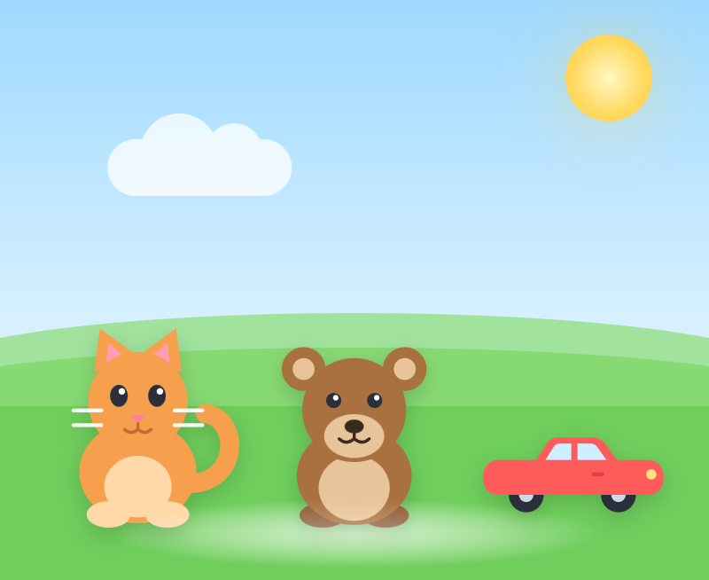

# Nikolai's Game

A tiny touch game for a one-year-old. Tap the cat, the bear or the car — each
one hops and makes a sound.

## Play

Open `index.html` in any modern browser. No server, no installation, no
internet connection needed.

Online version: **https://zik69.github.io/nikolai-game/**

## What is inside

- **One file.** Everything — pictures, sounds, code — lives in `index.html`.
- **Works offline.** There is not a single link to the internet, so nothing can
  fail to load. A strict Content-Security-Policy stops the page from making any
  network request at all, even by accident.
- **Big targets.** A button is a whole grid cell. On a 320 px phone the
  smallest one is still 243 × 163 px.
- **Two layouts.** Landscape keeps the three characters in a row; portrait
  stacks them, full width.
- **Real sounds, no files.** The meow, the growl and the horn are synthesized
  with the Web Audio API.
- **Safe for small hands.** No scrolling, no pinch zoom, no double-tap zoom,
  no long-press menu, no text to read.
- **Parent lock.** A faint dot in the top-left corner opens after a three-second
  hold: sound on/off, play time (5/10/15/30 minutes), exit with confirmation.
  The panel closes itself after 30 seconds.
- **Gentle time limit.** When the time is up, a calm night screen appears and
  taps stop working. Only an adult can bring the game back.
- **No ads, no tracking, no accounts.** Nothing leaves the device.

## On an iPad

Open the online link in Safari, or save `index.html` to the Files app and open
it from there. Safari does not allow web pages to go full screen, so the
address bar stays visible — that is a browser limitation, not a bug.

Sound starts on the very first tap, which is what iOS requires.

## Project documents (in Russian)

- `docs/ROADMAP.md` — the plan, written as user stories.
- `docs/CHANGELOG.md` — what has been done so far.
- `docs/tasks/` — one folder per task, with a plain-language description and a
  ready-to-use prompt for an AI assistant.

## Roadmap in one line

All P0 tasks are done: safe full-screen frame, three big buttons, sounds, a
parent lock with a gentle time limit, and a fully offline single file. Next:
the fun part — peekaboo, bubbles, music.
